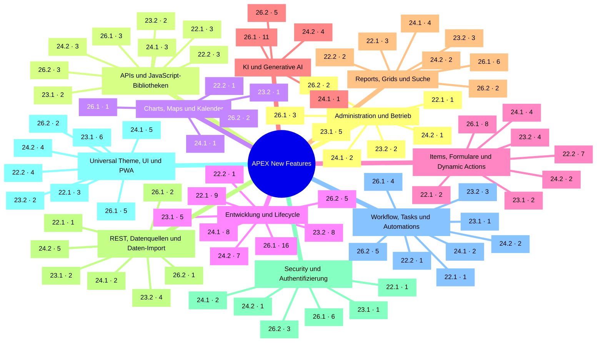
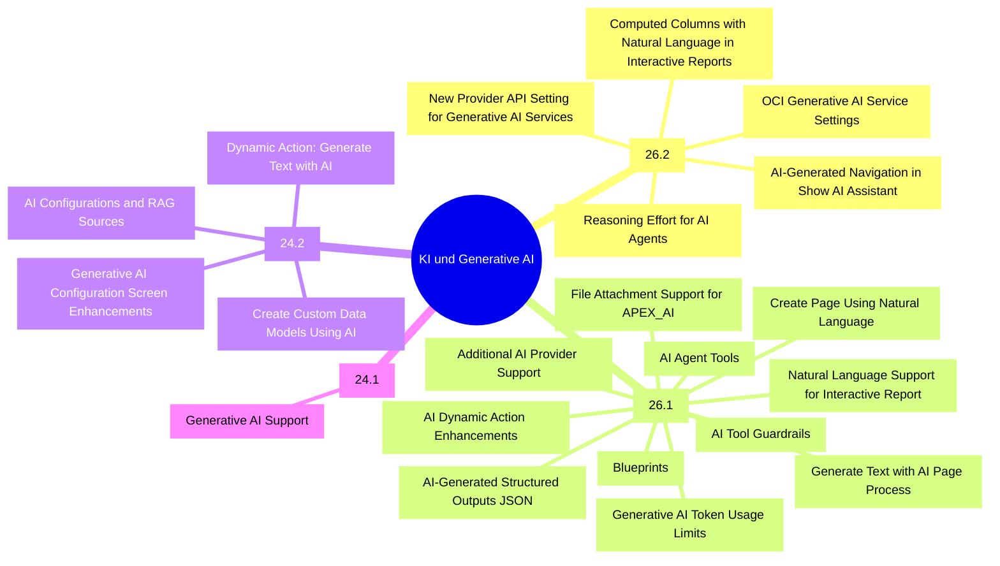

# Diagramm-Test (Branch test/diagramme)

Testdatei, um zu prüfen, welche Darstellungen GitHub rendert. Datenbasis: `apex-new-features.md`.

## 1. Mermaid-Version auf GitHub

```mermaid
info
```

## 2a. Mindmap: Kategorien → Releases (22.1 – 26.2, Anzahl neuer Features)



## 2b. Mindmap: KI und Generative AI → Release → Feature



## 3. Heatmap (Emoji-Tabelle): neue Features je Kategorie und Release

Legende: ⬜ 0 · 🟨 1–2 · 🟧 3–5 · 🟥 6 und mehr

| Kategorie | 26.2 | 26.1 | 24.2 | 24.1 | 23.2 | 23.1 | 22.2 | 22.1 | 21.2 | 21.1 | 20.2 | 20.1 | 19.2 | 19.1 | 18.2 | 18.1 |
|:--|:-:|:-:|:-:|:-:|:-:|:-:|:-:|:-:|:-:|:-:|:-:|:-:|:-:|:-:|:-:|:-:|
| Administration und Betrieb | 🟨 2 | 🟧 3 | 🟨 1 | 🟨 2 | 🟨 2 | 🟧 5 | ⬜ | 🟨 1 | 🟨 2 | ⬜ | ⬜ | ⬜ | ⬜ | ⬜ | ⬜ | ⬜ |
| APIs und JavaScript-Bibliotheken | 🟧 3 | 🟧 3 | 🟧 3 | 🟧 3 | 🟨 2 | 🟨 2 | 🟧 3 | 🟧 3 | 🟨 2 | 🟨 2 | 🟨 2 | 🟨 2 | 🟧 3 | 🟨 1 | 🟨 1 | 🟨 1 |
| Charts, Maps und Kalender | 🟨 2 | 🟨 1 | ⬜ | 🟨 1 | 🟨 1 | ⬜ | 🟨 1 | ⬜ | 🟨 1 | 🟨 2 | ⬜ | ⬜ | ⬜ | 🟨 2 | ⬜ | 🟧 4 |
| Entwicklung und Lifecycle | 🟧 5 | 🟥 16 | 🟥 7 | 🟥 8 | 🟥 8 | 🟧 5 | 🟨 1 | 🟥 9 | 🟧 4 | 🟧 4 | 🟨 1 | 🟧 4 | 🟧 3 | 🟨 2 | 🟧 3 | 🟨 2 |
| Items, Formulare und Dynamic Actions | ⬜ | 🟥 8 | 🟨 2 | 🟧 4 | 🟧 4 | 🟨 2 | 🟥 7 | 🟨 2 | ⬜ | 🟧 3 | 🟨 1 | ⬜ | 🟨 2 | 🟨 2 | 🟨 1 | ⬜ |
| KI und Generative AI | 🟧 5 | 🟥 11 | 🟧 4 | 🟨 1 | ⬜ | ⬜ | ⬜ | ⬜ | ⬜ | ⬜ | ⬜ | ⬜ | ⬜ | ⬜ | ⬜ | ⬜ |
| Reports, Grids und Suche | 🟨 2 | 🟥 6 | 🟨 2 | 🟧 4 | 🟧 3 | ⬜ | 🟨 2 | 🟧 3 | 🟧 3 | 🟧 3 | 🟧 4 | 🟧 4 | 🟧 4 | ⬜ | ⬜ | ⬜ |
| REST, Datenquellen und Daten-Import | 🟨 1 | 🟨 2 | 🟧 5 | 🟨 2 | 🟧 4 | 🟨 2 | ⬜ | 🟨 1 | 🟨 1 | 🟨 2 | 🟧 3 | ⬜ | 🟧 3 | 🟨 1 | ⬜ | 🟨 2 |
| Security und Authentifizierung | 🟧 3 | 🟥 6 | 🟨 1 | 🟨 2 | ⬜ | 🟨 1 | ⬜ | 🟨 1 | ⬜ | ⬜ | 🟨 1 | ⬜ | ⬜ | ⬜ | ⬜ | 🟨 1 |
| Universal Theme, UI und PWA | 🟨 2 | 🟧 5 | 🟧 4 | 🟧 5 | 🟨 2 | 🟥 6 | 🟧 4 | 🟧 3 | 🟧 4 | 🟨 2 | 🟧 3 | 🟧 3 | 🟨 2 | 🟨 2 | 🟨 1 | 🟨 1 |
| Workflow, Tasks und Automations | 🟧 5 | 🟧 4 | 🟨 2 | 🟨 2 | 🟧 3 | 🟨 1 | 🟨 1 | 🟨 1 | ⬜ | ⬜ | 🟨 1 | ⬜ | ⬜ | ⬜ | ⬜ | ⬜ |
