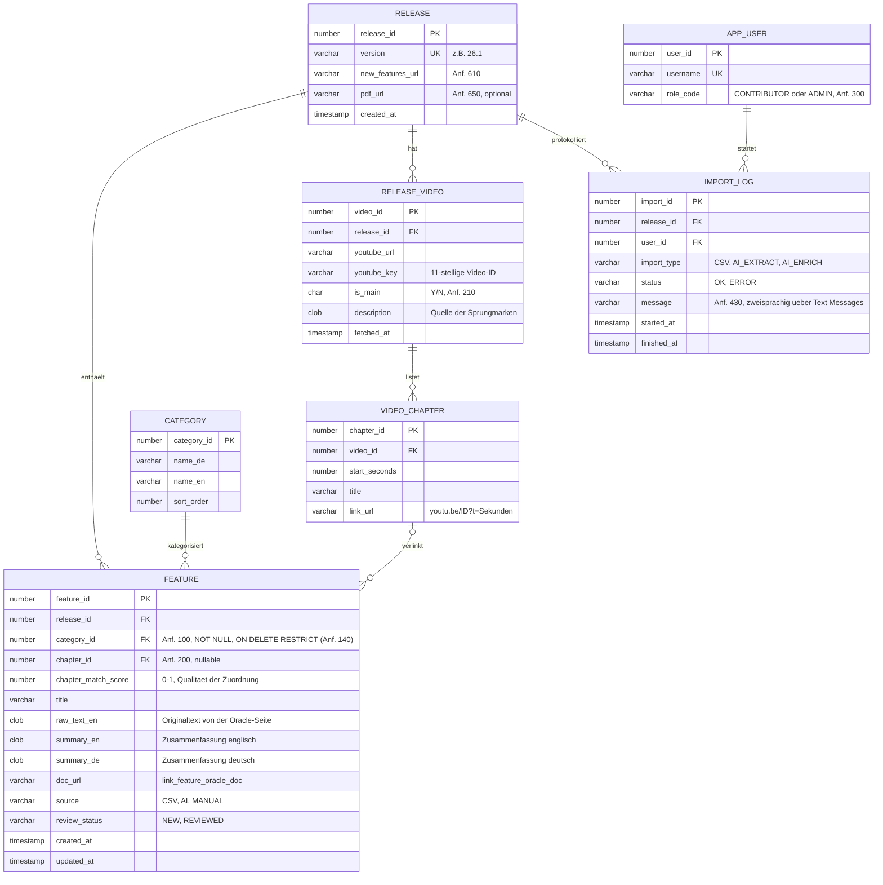

# ER-Modell: APEX New Features App

Basis: [anforderungen_nfo.md](anforderungen_nfo.md), Stand der Anforderungen 100–640.

## Entwurfsentscheidungen

- **Zweisprachigkeit:** `summary_de` und `summary_en` sind Spalten in `FEATURE`. Bei nur zwei Sprachen ist das einfacher als eine Übersetzungstabelle und passt zu `desc_de`/`desc_en` aus Anforderung 440. Der Originaltext (`raw_text_en`) bleibt getrennt, damit die KI jederzeit neu zusammenfassen kann.
- **Kategorien:** `FEATURE` verweist per ID auf `CATEGORY`, daher bleiben Umbenennen (160) und Verschieben (130) einfache Updates. Der Fremdschlüssel verhindert das Löschen einer belegten Kategorie (140). `name_en` ist für den Sprachwechsel (500) vorgesehen.
- **YouTube:** Sprungmarken stehen getrennt in `VIDEO_CHAPTER` (220). Ein Feature zeigt auf höchstens eine Sprungmarke (200). Auch nicht zugeordnete Kapitel bleiben sichtbar. Fehlt jede Sprungmarke, zeigt die App "Keine Sprungmarken gefunden" (230).
- **KI-Kontrolle:** `source` und `review_status` markieren KI-Ergebnisse, damit ein Contributor sie prüfen kann.
- **Rollen:** `APP_USER.role_code` ist eine einfache Lösung. Alternativ gibt es in APEX die integrierte Funktion Application Access Control.
