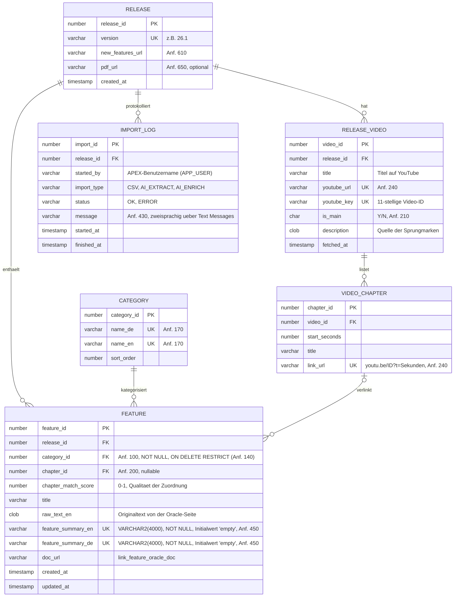

# ER-Modell: APEX New Features App

Basis: [nfo_specification.md](nfo_specification.md), Stand der Anforderungen 100–650.

## Entwurfsentscheidungen

- **Zweisprachigkeit:** `feature_summary_de` und `feature_summary_en` sind Spalten in `FEATURE`. Bei nur zwei Sprachen ist das einfacher als eine Übersetzungstabelle und passt zu den gleichnamigen CSV-Spalten aus Anforderung 440. Der Originaltext (`raw_text_en`) bleibt getrennt, damit die KI jederzeit neu zusammenfassen kann.
- **Kategorien:** `FEATURE` verweist per ID auf `CATEGORY`, daher bleiben Umbenennen (160) und Verschieben (130) einfache Updates. Der Fremdschlüssel verhindert das Löschen einer belegten Kategorie (140). `name_en` ist für den Sprachwechsel (500) vorgesehen.
- **YouTube:** Sprungmarken stehen getrennt in `VIDEO_CHAPTER` (220). Ein Feature zeigt auf höchstens eine Sprungmarke (200). Auch nicht zugeordnete Kapitel bleiben sichtbar. Fehlt jede Sprungmarke, zeigt die App "Keine Sprungmarken gefunden" (230).
- **Eindeutigkeit:** Kategorienamen (170), Feature-Beschreibungen (450) sowie YouTube-Links von Release-Videos und Sprungmarken (240) sind jeweils eindeutig. `feature_summary_de`/`feature_summary_en` sind deshalb `VARCHAR2(4000)` statt CLOB, denn auf CLOB-Spalten erlaubt Oracle keinen Unique Constraint.
- **Kein Überschreiben:** `feature_summary_de`/`feature_summary_en` sind NOT NULL mit dem Initialwert `'empty'`. Ein Update mit leerem Wert, etwa von einer Seite ohne dieses Feld, scheitert, statt den gespeicherten Text zu löschen. Die Eindeutigkeit (450) gilt für alle Werte außer `'empty'` (funktionsbasierter Unique Index).
- **Rollen:** Benutzer und Rollen (Anf. 300) verwaltet die in APEX integrierte Application Access Control mit den Rollen `CONTRIBUTOR` und `ADMINISTRATOR`. Eine eigene Benutzertabelle entfällt. Seiten und Komponenten werden über Authorization Schemes abgesichert, die auf diese Rollen prüfen. Die Zuordnungen stehen in den Views `APEX_APPL_ACL_USERS` und `APEX_APPL_ACL_USER_ROLES`. Gepflegt werden sie über die Access-Control-Seiten der App oder per `APEX_ACL`. `IMPORT_LOG.started_by` speichert deshalb nur den APEX-Benutzernamen (`APP_USER`) und hat keinen Fremdschlüssel.
