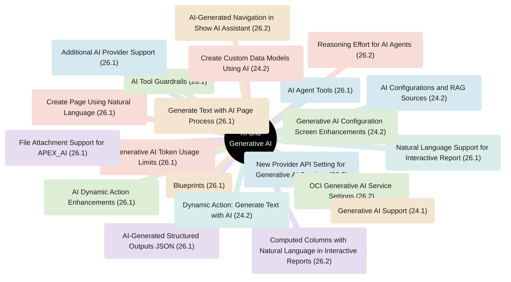
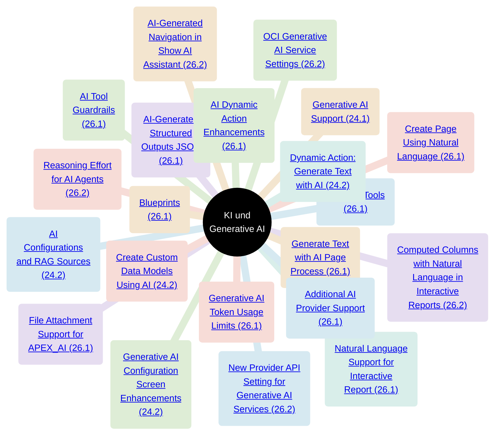

# Oracle APEX – KI und Generative AI Features

KI-Features der Releases 24.1 bis 26.2 als Mindmap und als Diagramm. Jedes Feature verlinkt direkt auf seinen Abschnitt in den Oracle Release Notes.

## Mindmap

## Mindmap mit Links

## Diagramm mit Links

```mermaid
---
config:
  theme: base
  themeVariables:
    fontSize: 14px
    primaryColor: "#312D2A"
    primaryTextColor: "#ffffff"
    lineColor: "#C74634"
    cScale0: "#312D2A"
    cScaleLabel0: "#ffffff"
    cScale1: "#F7DCD7"
    cScaleLabel1: "#1F1B18"
    cScale2: "#D6E9F1"
    cScaleLabel2: "#1F1B18"
    cScale3: "#DEEDD6"
    cScaleLabel3: "#1F1B18"
    cScale4: "#F3E5CF"
    cScaleLabel4: "#1F1B18"
    cScale5: "#E6DDF0"
    cScaleLabel5: "#1F1B18"
    cScale6: "#D9EEEA"
    cScaleLabel6: "#1F1B18"
    cScale7: "#F7DCD7"
    cScaleLabel7: "#1F1B18"
    cScale8: "#D6E9F1"
    cScaleLabel8: "#1F1B18"
    cScale9: "#DEEDD6"
    cScaleLabel9: "#1F1B18"
    cScale10: "#F3E5CF"
    cScaleLabel10: "#1F1B18"
    cScale11: "#E6DDF0"
    cScaleLabel11: "#1F1B18"
---
flowchart LR
  root(("KI und<br/>Generative AI"))
  root --- f1("Reasoning Effort for AI Agents (26.2)")
  root --- f2("New Provider API Setting for Generative AI Services (26.2)")
  root --- f3("OCI Generative AI Service Settings (26.2)")
  root --- f4("AI-Generated Navigation in Show AI Assistant (26.2)")
  root --- f5("Computed Columns with Natural Language in Interactive Reports (26.2)")
  root --- f6("Natural Language Support for Interactive Report (26.1)")
  root --- f7("Create Page Using Natural Language (26.1)")
  root --- f8("AI Agent Tools (26.1)")
  root --- f9("AI Tool Guardrails (26.1)")
  root --- f10("Generate Text with AI Page Process (26.1)")
  root --- f11("AI-Generated Structured Outputs JSON (26.1)")
  root --- f12("Generative AI Token Usage Limits (26.1)")
  root --- f13("Additional AI Provider Support (26.1)")
  root --- f14("AI Dynamic Action Enhancements (26.1)")
  root --- f15("Blueprints (26.1)")
  root --- f16("File Attachment Support for APEX_AI (26.1)")
  root --- f17("Dynamic Action: Generate Text with AI (24.2)")
  root --- f18("Create Custom Data Models Using AI (24.2)")
  root --- f19("AI Configurations and RAG Sources (24.2)")
  root --- f20("Generative AI Configuration Screen Enhancements (24.2)")
  root --- f21("Generative AI Support (24.1)")
  click f1 href "https://docs.oracle.com/en/database/oracle/apex/26.2/htmrn/new-features.html#GUID-E3EC1EE4-8A4E-4CBE-9303-D5C170FA6DC9" _blank
  click f2 href "https://docs.oracle.com/en/database/oracle/apex/26.2/htmrn/new-features.html#GUID-31C88C7A-697C-46D6-AA1B-8C61D73A3607" _blank
  click f3 href "https://docs.oracle.com/en/database/oracle/apex/26.2/htmrn/new-features.html#GUID-112154A3-8209-4129-A363-DCF87183818D" _blank
  click f4 href "https://docs.oracle.com/en/database/oracle/apex/26.2/htmrn/new-features.html#GUID-6AAA6EDC-D109-40FF-AFE4-B3BFEF064105" _blank
  click f5 href "https://docs.oracle.com/en/database/oracle/apex/26.2/htmrn/new-features.html#GUID-4B21AEBB-7A81-4DB8-9ECD-9728E64C0AA8" _blank
  click f6 href "https://docs.oracle.com/en/database/oracle/apex/26.1/htmrn/new-features.html#GUID-97FD585A-B2FE-4D83-8EC9-B014CFA94A4F" _blank
  click f7 href "https://docs.oracle.com/en/database/oracle/apex/26.1/htmrn/new-features.html#GUID-65875D64-78DE-48CF-B9AE-1AD535FBC62A" _blank
  click f8 href "https://docs.oracle.com/en/database/oracle/apex/26.1/htmrn/new-features.html#GUID-D8D70E73-BF6C-4CF3-8B3A-B20C2463AA92" _blank
  click f9 href "https://docs.oracle.com/en/database/oracle/apex/26.1/htmrn/new-features.html#GUID-D4DFB073-9A1D-4819-89BB-E223189FA7EA" _blank
  click f10 href "https://docs.oracle.com/en/database/oracle/apex/26.1/htmrn/new-features.html#GUID-64E68A65-83E3-4E27-BB9B-6A93491E3360" _blank
  click f11 href "https://docs.oracle.com/en/database/oracle/apex/26.1/htmrn/new-features.html#GUID-32B7FD4E-822A-4F31-995A-49629F46D05E" _blank
  click f12 href "https://docs.oracle.com/en/database/oracle/apex/26.1/htmrn/new-features.html#GUID-90A11DF5-356B-498D-8305-C0F4358265FA" _blank
  click f13 href "https://docs.oracle.com/en/database/oracle/apex/26.1/htmrn/new-features.html#GUID-2BBD7696-4F50-4DEF-834A-0DA80D26DF57" _blank
  click f14 href "https://docs.oracle.com/en/database/oracle/apex/26.1/htmrn/new-features.html#GUID-4378479C-E9E8-4D00-9B77-5894E56BDFB8" _blank
  click f15 href "https://docs.oracle.com/en/database/oracle/apex/26.1/htmrn/new-features.html#GUID-4DEE6D63-8818-419B-9111-769AF8661AD2" _blank
  click f16 href "https://docs.oracle.com/en/database/oracle/apex/26.1/htmrn/new-features.html#GUID-D44EA632-F671-46CB-9AF7-B364E8843351" _blank
  click f17 href "https://docs.oracle.com/en/database/oracle/apex/24.2/htmrn/new-features.html#GUID-3E6CC92E-A56C-4002-BC68-072A14D66D86" _blank
  click f18 href "https://docs.oracle.com/en/database/oracle/apex/24.2/htmrn/new-features.html#GUID-9BE115BE-5CFA-4A68-8FBB-3AFDCAD752FB" _blank
  click f19 href "https://docs.oracle.com/en/database/oracle/apex/24.2/htmrn/new-features.html#GUID-53C1F273-1F73-4E3F-BFC2-EDA2B1DABA93" _blank
  click f20 href "https://docs.oracle.com/en/database/oracle/apex/24.2/htmrn/new-features.html#GUID-3E75A967-82A2-42D5-8950-4B050B47507D" _blank
  click f21 href "https://docs.oracle.com/en/database/oracle/apex/24.1/htmrn/new-features.html#GUID-58986BEB-A222-4976-A48E-E364DAD38406" _blank
  classDef feat fill:#FBF9F8,stroke:#C74634,color:#312D2A
  classDef rt fill:#312D2A,stroke:#312D2A,color:#fff
  class root rt
  class f1,f2,f3,f4,f5,f6,f7,f8,f9,f10,f11,f12,f13,f14,f15,f16,f17,f18,f19,f20,f21 feat
```

