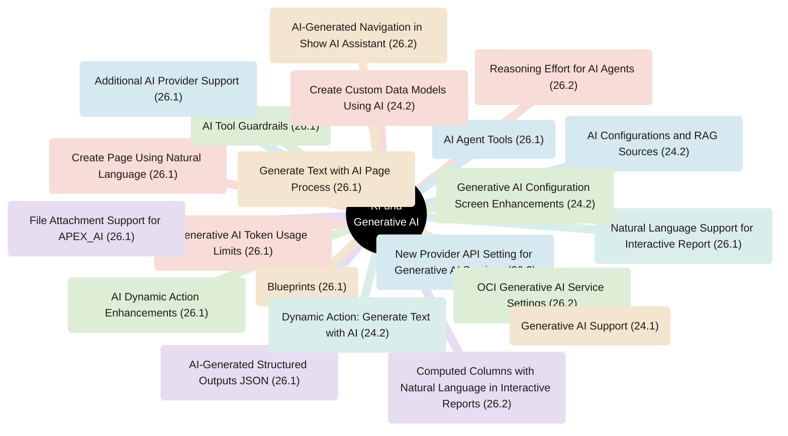
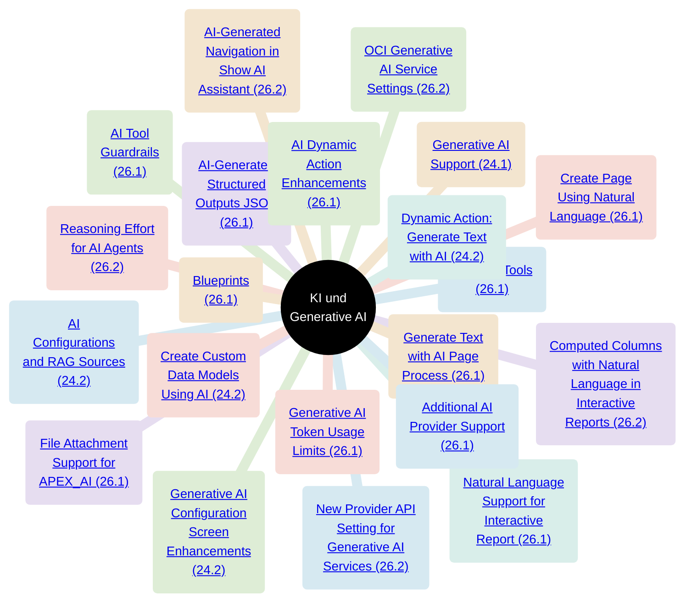

# Mindmap-Test KI (Branch test/diagramme)

Varianten, um Optik und klickbare Links auf GitHub zu prüfen.

## A. Mindmap ohne Release-Ebene (ohne Links)

## C3. Mindmap ohne Release-Ebene, mit Links

## D. Flowchart mit click-Links

```mermaid
---
config:
  theme: base
  themeVariables:
    fontSize: 14px
    primaryColor: "#312D2A"
    primaryTextColor: "#ffffff"
    lineColor: "#C74634"
    cScale0: "#312D2A"
    cScaleLabel0: "#ffffff"
    cScale1: "#F7DCD7"
    cScaleLabel1: "#1F1B18"
    cScale2: "#D6E9F1"
    cScaleLabel2: "#1F1B18"
    cScale3: "#DEEDD6"
    cScaleLabel3: "#1F1B18"
    cScale4: "#F3E5CF"
    cScaleLabel4: "#1F1B18"
    cScale5: "#E6DDF0"
    cScaleLabel5: "#1F1B18"
    cScale6: "#D9EEEA"
    cScaleLabel6: "#1F1B18"
    cScale7: "#F7DCD7"
    cScaleLabel7: "#1F1B18"
    cScale8: "#D6E9F1"
    cScaleLabel8: "#1F1B18"
    cScale9: "#DEEDD6"
    cScaleLabel9: "#1F1B18"
    cScale10: "#F3E5CF"
    cScaleLabel10: "#1F1B18"
    cScale11: "#E6DDF0"
    cScaleLabel11: "#1F1B18"
---
flowchart LR
  root(("KI und<br/>Generative AI"))
  root --- r262{{"APEX 26.2"}}
  r262 --- r262_0("Reasoning Effort for AI Agents")
  r262 --- r262_1("New Provider API Setting for Generative AI Services")
  r262 --- r262_2("OCI Generative AI Service Settings")
  r262 --- r262_3("AI-Generated Navigation in Show AI Assistant")
  r262 --- r262_4("Computed Columns with Natural Language in Interactive Reports")
  root --- r261{{"APEX 26.1"}}
  r261 --- r261_0("Natural Language Support for Interactive Report")
  r261 --- r261_1("Create Page Using Natural Language")
  r261 --- r261_2("AI Agent Tools")
  r261 --- r261_3("AI Tool Guardrails")
  r261 --- r261_4("Generate Text with AI Page Process")
  r261 --- r261_5("AI-Generated Structured Outputs JSON")
  r261 --- r261_6("Generative AI Token Usage Limits")
  r261 --- r261_7("Additional AI Provider Support")
  r261 --- r261_8("AI Dynamic Action Enhancements")
  r261 --- r261_9("Blueprints")
  r261 --- r261_10("File Attachment Support for APEX_AI")
  root --- r242{{"APEX 24.2"}}
  r242 --- r242_0("Dynamic Action: Generate Text with AI")
  r242 --- r242_1("Create Custom Data Models Using AI")
  r242 --- r242_2("AI Configurations and RAG Sources")
  r242 --- r242_3("Generative AI Configuration Screen Enhancements")
  root --- r241{{"APEX 24.1"}}
  r241 --- r241_0("Generative AI Support")
  click r262_0 href "https://docs.oracle.com/en/database/oracle/apex/26.2/htmrn/new-features.html#GUID-E3EC1EE4-8A4E-4CBE-9303-D5C170FA6DC9" _blank
  click r262_1 href "https://docs.oracle.com/en/database/oracle/apex/26.2/htmrn/new-features.html#GUID-31C88C7A-697C-46D6-AA1B-8C61D73A3607" _blank
  click r262_2 href "https://docs.oracle.com/en/database/oracle/apex/26.2/htmrn/new-features.html#GUID-112154A3-8209-4129-A363-DCF87183818D" _blank
  click r262_3 href "https://docs.oracle.com/en/database/oracle/apex/26.2/htmrn/new-features.html#GUID-6AAA6EDC-D109-40FF-AFE4-B3BFEF064105" _blank
  click r262_4 href "https://docs.oracle.com/en/database/oracle/apex/26.2/htmrn/new-features.html#GUID-4B21AEBB-7A81-4DB8-9ECD-9728E64C0AA8" _blank
  click r261_0 href "https://docs.oracle.com/en/database/oracle/apex/26.1/htmrn/new-features.html#GUID-97FD585A-B2FE-4D83-8EC9-B014CFA94A4F" _blank
  click r261_1 href "https://docs.oracle.com/en/database/oracle/apex/26.1/htmrn/new-features.html#GUID-65875D64-78DE-48CF-B9AE-1AD535FBC62A" _blank
  click r261_2 href "https://docs.oracle.com/en/database/oracle/apex/26.1/htmrn/new-features.html#GUID-D8D70E73-BF6C-4CF3-8B3A-B20C2463AA92" _blank
  click r261_3 href "https://docs.oracle.com/en/database/oracle/apex/26.1/htmrn/new-features.html#GUID-D4DFB073-9A1D-4819-89BB-E223189FA7EA" _blank
  click r261_4 href "https://docs.oracle.com/en/database/oracle/apex/26.1/htmrn/new-features.html#GUID-64E68A65-83E3-4E27-BB9B-6A93491E3360" _blank
  click r261_5 href "https://docs.oracle.com/en/database/oracle/apex/26.1/htmrn/new-features.html#GUID-32B7FD4E-822A-4F31-995A-49629F46D05E" _blank
  click r261_6 href "https://docs.oracle.com/en/database/oracle/apex/26.1/htmrn/new-features.html#GUID-90A11DF5-356B-498D-8305-C0F4358265FA" _blank
  click r261_7 href "https://docs.oracle.com/en/database/oracle/apex/26.1/htmrn/new-features.html#GUID-2BBD7696-4F50-4DEF-834A-0DA80D26DF57" _blank
  click r261_8 href "https://docs.oracle.com/en/database/oracle/apex/26.1/htmrn/new-features.html#GUID-4378479C-E9E8-4D00-9B77-5894E56BDFB8" _blank
  click r261_9 href "https://docs.oracle.com/en/database/oracle/apex/26.1/htmrn/new-features.html#GUID-4DEE6D63-8818-419B-9111-769AF8661AD2" _blank
  click r261_10 href "https://docs.oracle.com/en/database/oracle/apex/26.1/htmrn/new-features.html#GUID-D44EA632-F671-46CB-9AF7-B364E8843351" _blank
  click r242_0 href "https://docs.oracle.com/en/database/oracle/apex/24.2/htmrn/new-features.html#GUID-3E6CC92E-A56C-4002-BC68-072A14D66D86" _blank
  click r242_1 href "https://docs.oracle.com/en/database/oracle/apex/24.2/htmrn/new-features.html#GUID-9BE115BE-5CFA-4A68-8FBB-3AFDCAD752FB" _blank
  click r242_2 href "https://docs.oracle.com/en/database/oracle/apex/24.2/htmrn/new-features.html#GUID-53C1F273-1F73-4E3F-BFC2-EDA2B1DABA93" _blank
  click r242_3 href "https://docs.oracle.com/en/database/oracle/apex/24.2/htmrn/new-features.html#GUID-3E75A967-82A2-42D5-8950-4B050B47507D" _blank
  click r241_0 href "https://docs.oracle.com/en/database/oracle/apex/24.1/htmrn/new-features.html#GUID-58986BEB-A222-4976-A48E-E364DAD38406" _blank
  classDef rel fill:#C74634,stroke:#C74634,color:#fff,font-weight:bold
  classDef feat fill:#FBF9F8,stroke:#C74634,color:#312D2A
  classDef rt fill:#312D2A,stroke:#312D2A,color:#fff
  class root rt
  class r262,r261,r242,r241 rel
  class r262_0,r262_1,r262_2,r262_3,r262_4,r261_0,r261_1,r261_2,r261_3,r261_4,r261_5,r261_6,r261_7,r261_8,r261_9,r261_10,r242_0,r242_1,r242_2,r242_3,r241_0 feat
```

